# 練習が楽しくなるビジュアルチューナー「VISUAL TUNER」を作りました｜音程が合うと、画面が弾ける

<!-- 見出し画像：images/00_header.jpg -->

楽器のチューニングや音程の練習って、正直ちょっと地味じゃないですか？

メーターの針をじっと見て、「あと少し高い…低い…」とにらめっこ。大事なことだとわかっていても、なかなか続きません。

そこで、音程がピタッと合った瞬間に、画面がド派手に盛り上がるチューナーを作りました。名前は「VISUAL TUNER（ビジュアルチューナー）」。ブラウザで開くだけで使えて、スマホでもパソコンでも動きます。

👉 【ここにURLを貼る】

---

## 合った瞬間、世界が変わる

使い方はかんたん。「マイクで始める」を押して、楽器や声で音を出すだけです。

音程が ±3セント（ほんのわずかなズレ）の中に入ると「PERFECT!」。そこから合わせ続けるほど、コンボが伸びて演出がどんどん激しくなります。

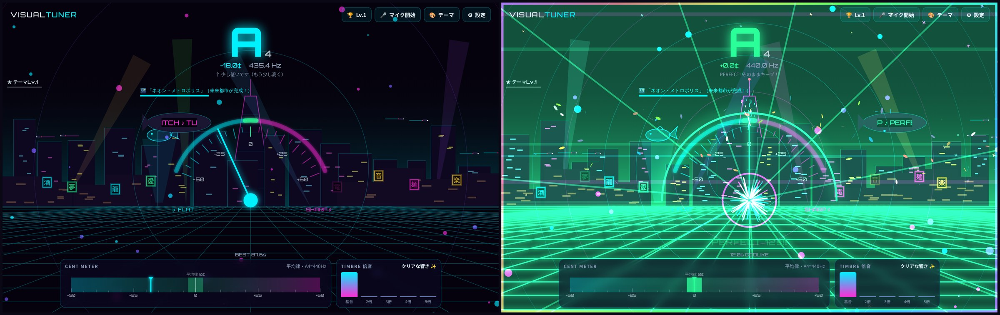
*左がズレているとき、右がピッタリ合ったとき。ネオンの街にレーザーが飛び交い、画面が一気に弾けます*

3秒で「NICE!」、5秒で「GREAT!!」、10秒を超えると「FEVER TIME!!」。画面のふちが虹色に光り出して、思わず「もうちょっと伸ばしたい…！」となります。

## 演出は全部で50種類

ゲーム風、和風、癒し系まで、テーマは全部で50種類。しかも、どのテーマも「練習すると育つ」のがポイントです。合わせ続けた時間がたまると、景色や仲間や道具がどんどん増えていきます。いくつか紹介します。

### 👾 レトロゲーム：相棒モンスターが進化する

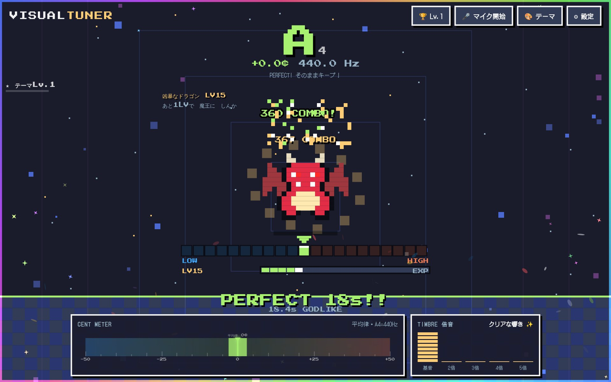
*合わせた時間だけ経験値がたまり、相棒モンスターがスライム→コウモリ→ゴースト→ゴーレム→ドラゴン→魔王と進化していきます*

### 🌊 ディープ・オーシャン：海の仲間が増えていく

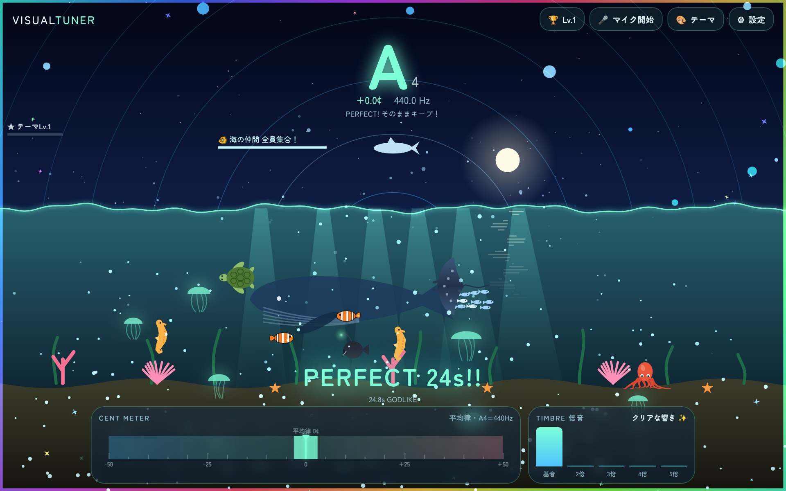
*ズレていると海が荒れ、合うと鏡のような凪に。練習を続けると、クラゲ・クマノミ・ウミガメ・マンタ・クジラ…と海の仲間が増えていきます*

### 🎆 花火大会：打ち上がる花火の種類が増える

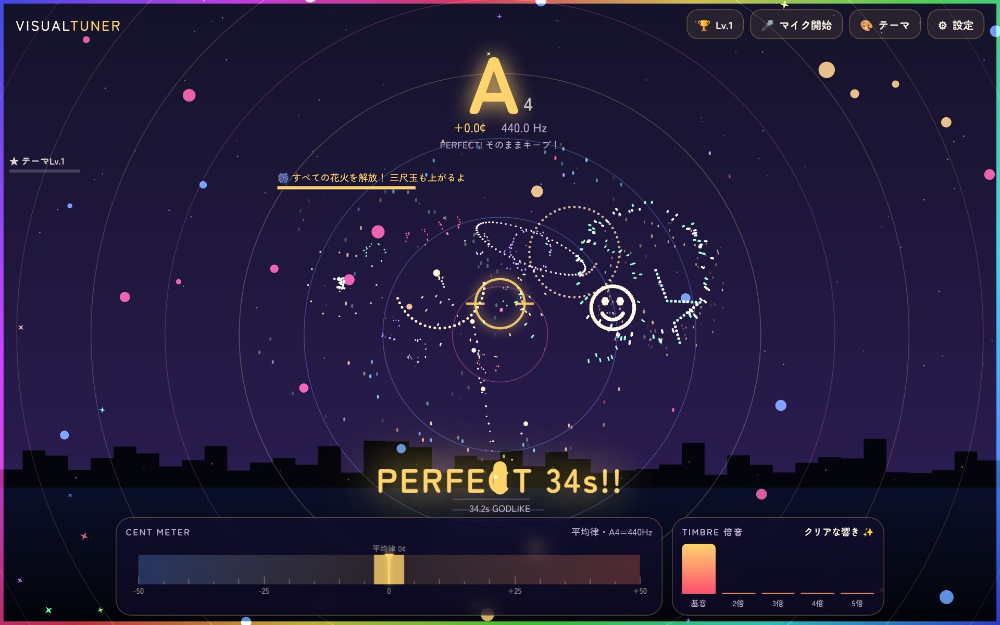
*音程のズレで打ち上げ筒が傾き、合うと大玉が連発。菊・牡丹・柳・土星・ニコちゃん…と増えて、最後は三尺玉まで打ち上がります*

### 🌸 夜桜：若木が育って、お花見の宴へ

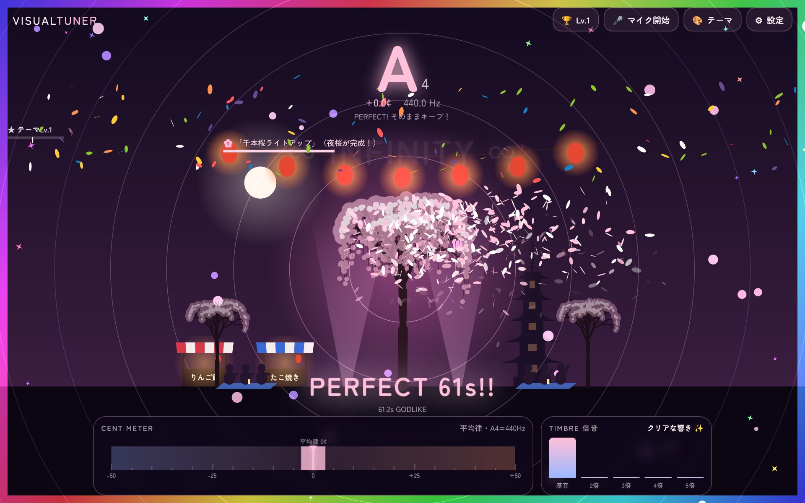
*つぼみの若木から始まり、提灯・夜店・五重塔・しだれ桜…と、合わせるほど夜桜の景色がにぎやかになります*

### 🎯 アーチェリー：的が遠ざかり、武器が進化

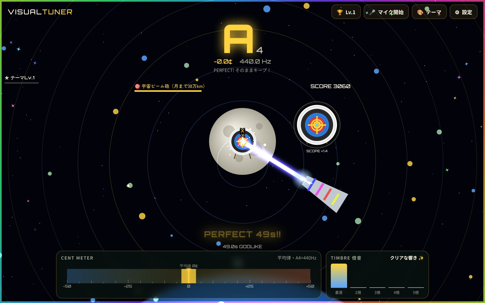
*照準の位置が音程のズレ。レベルが上がると的がどんどん遠くへ。弓矢から始まって、最後は「宇宙ビーム砲」で月の的をねらいます*

### 🔥 焚き火：火起こしから、どんど焼きまで

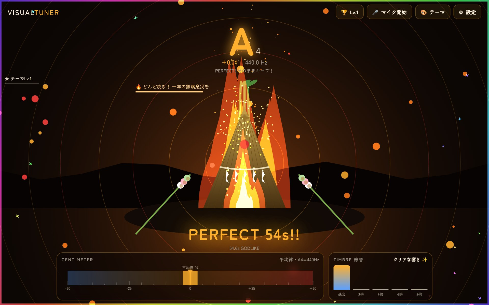
*木の棒をこする「火起こし」から始まり、小さな焚き火→キャンプファイヤー→どんど焼きへ。炎の色は、低いと青く、高いと赤くなります*

### ✨ 星座図鑑：本物の星の並びで星座を集める

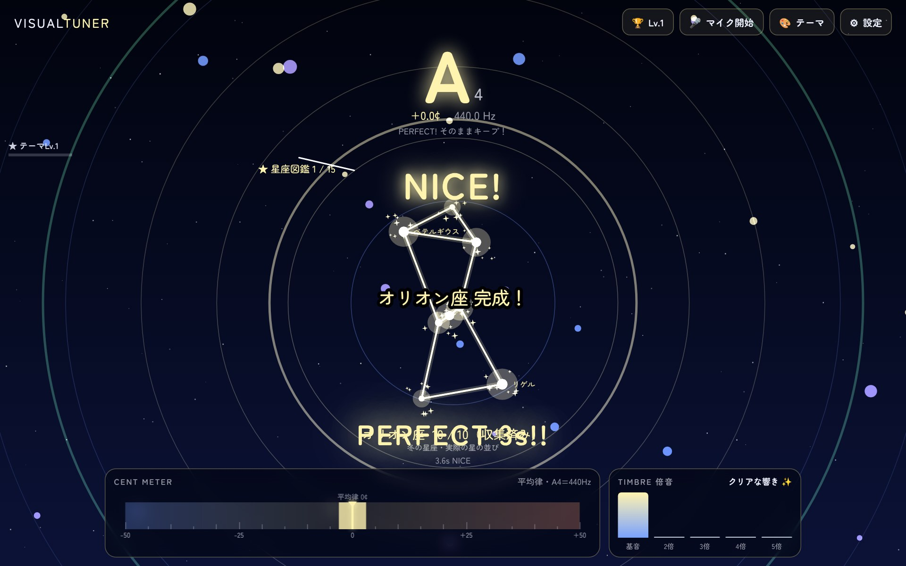
*合っている間だけ星と星が線でつながり、星座が完成すると図鑑に登録。実際の星の位置データから描いた15星座を集められます*

### 🖌️ 書道：書き順どおりに筆が動く

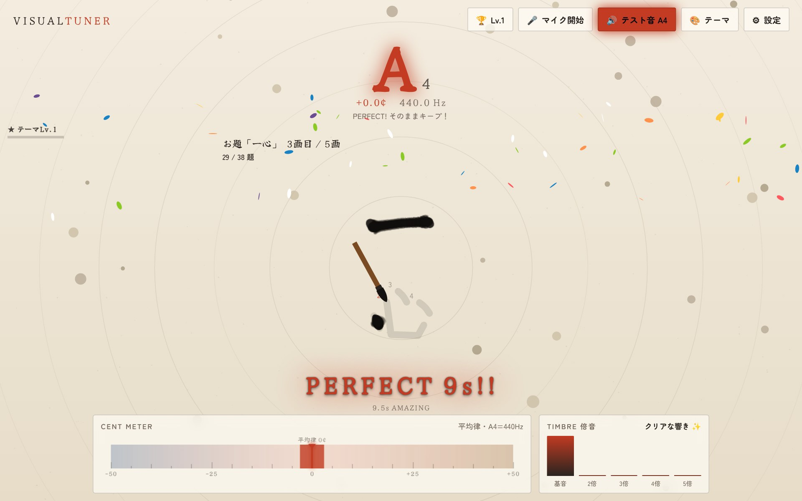
*音程が合っている間だけ、筆が書き順どおりに一画ずつ進みます。ズレると薄墨に。書き終わると「安定度」と落款が押されます*

ほかにも、鯉の池、オーロラ、ワープトンネル、スロット、ハチミツの巣、スピログラフ…などなど。

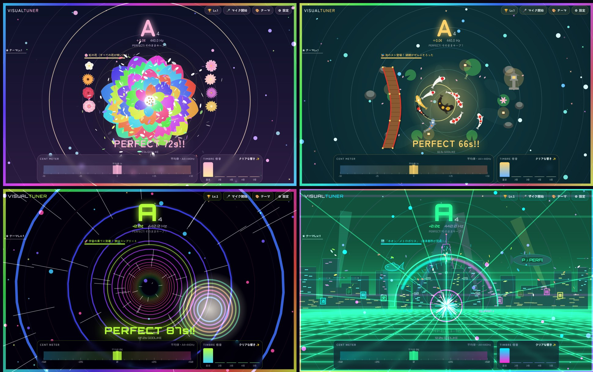
*オーガニック・フラワー（左上）、鯉の池（右上）、ワープトンネル（左下）、サイバーパンク・ネオン（右下）。どのテーマも、練習を続けると景色や仲間が増えていきます*

## 「続けたくなる」しかけ

チューナーは毎日使ってこそ。なので、続けたくなるしかけをたくさん入れました。

### 🔓 テーマは5種類ずつアンロック

最初に遊べるのは5種類だけ。その5種類をそれぞれ「テーマLv.3」まで育てると、次の5種類が解放されます。

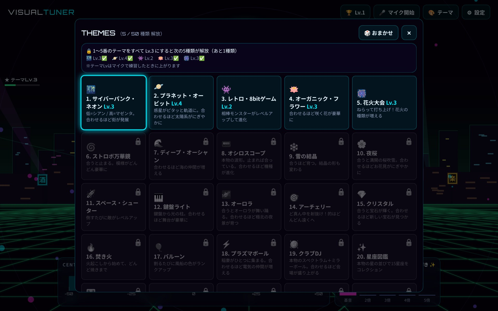
*テーマ一覧。まだ遊べないテーマには🔒マーク。上に「あと何種類で次が解放されるか」が表示されます*

### ⭐ ピッタリなほど早く育つ

各テーマはLv.1〜10まで育ちます。±1セント以内のピッタリな音程だと2倍の速さで育つので、自然と「より正確に」を目指したくなります。

### 🏆 記録と実績

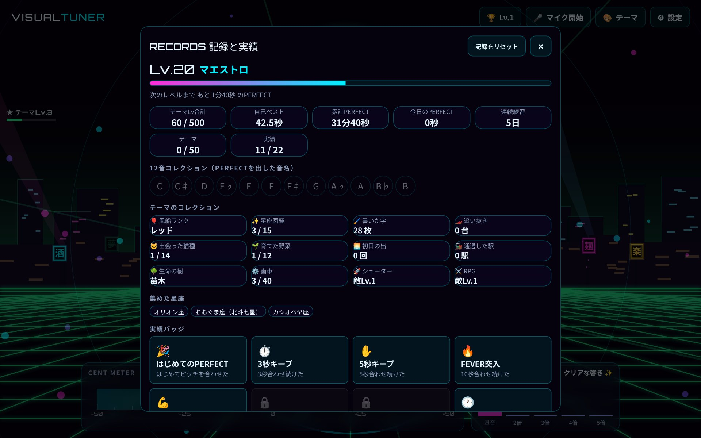
*記録画面。累計のPERFECT時間・自己ベスト・連続練習日数・12音コレクション・22個の実績バッジなどが見られます*

## スマホでも、もちろん使えます

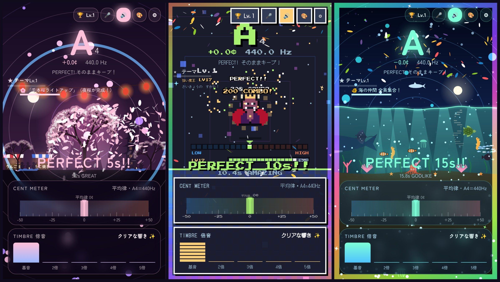
*スマホでの表示。演出エリアを左右にスワイプすると、テーマを切り替えられます*

スマホなら、譜面台に置いてそのまま練習にも使えます。画面のゆれが気になる方は、設定で「弱め」や「なし」にもできます。

## チューナーとしても本気です

見た目だけでなく、チューナーとしての中身もしっかり作りました。

- 高精度なピッチ検出：テストでの誤差は0.2セント以下
- 純正律モード／和音ボーナス：ハモり練習用に、長3度（−13.7セント）・完全5度（+2.0セント）など、きれいに響く音程を目標にできます
- 移調楽器に対応：B♭・E♭・F管の表示に切り替え可能
- 基準ピッチ：440Hz / 442Hz / 415Hz（古楽）
- 倍音の表示：音色の「クリアさ」「豊かさ」がわかります
セントメーターの見た目も、6種類から選べます。

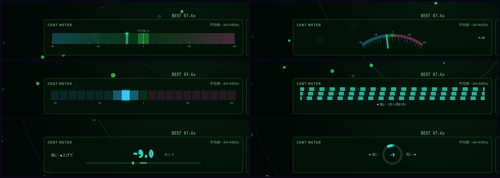
*セントメーターは「バー」「アナログ針」「LED」「ストロボ」「デジタル数字」「丸ダイヤル」の6種類。好みや楽器に合わせて選べます*

## 使い方

- 下のURLを開く（インストール不要）
- 「マイクで始める」を押して、マイクの使用を許可
- 楽器や声で音を出して、真ん中に合わせて「PERFECT!」を目指す
👉 【ここにURLを貼る】

※ マイクの音は端末の中だけで処理され、どこにも送信されません。

※ 記録はブラウザに保存されます。

## おわりに

「練習が楽しくなる」ことだけを考えて、思いつく限りの演出を詰め込みました。

チューニングの数秒が、ちょっとしたゲームの時間になったらうれしいです。感想や「こんなテーマがほしい！」というリクエストがあれば、ぜひコメントで教えてください🎵

#チューナー #楽器練習 #音楽 #吹奏楽 #Webアプリ #個人開発

